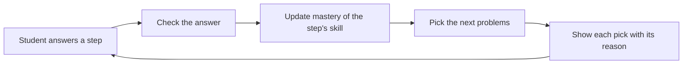

# Grassroot Personalized Practice

A practice engine that checks every step of a physics problem and picks the student's next problems from the step that went wrong, with a one-sentence reason for each.

[](https://github.com/jonathon-lockridge/grassroot-personalized-practice-internship/actions/workflows/ci.yml)

Jonathon Lockridge builds it as a high-school student and product design intern at [Grassroot Academy](https://grassroot.academy), with Grassroot's cofounder as his mentor. He sets the plan and makes the design decisions in [PRD.md](PRD.md).

Status: the engine, saved students and the simulated-student test work, with 315 automated tests. The physics course is under review (T1b), and the practice page (T4) comes next.

## The idea

A right-or-wrong mark on a whole physics problem hides where it went wrong. The student might have picked the wrong principle, found the wrong force, or slipped on the last line. Here each problem is split into steps, and each step practices one skill, so a wrong step points at the skill the student is stuck on. The engine estimates what the student knows, picks the next problems from that estimate, and tells the student why it picked each one.

The engine knows nothing about physics. A course is a data file of skills and problems, so a new subject means a new file and no new code. The first course is AP Physics C: Mechanics, energy and momentum, with 17 skills and 24 problems, the unit Jonathon is studying.

## An example

A new student works "Box sliding to a stop" and gets step 3 wrong (the box's starting kinetic energy). The engine's next three picks, copied from its output:

```text
push_cart      follow_up  Picked for you: you missed step 3 of Box sliding to a stop (Kinetic energy, K = ½mv²), so this problem practices that skill again.
car_power      partway    You are partway to mastering Find a force from Newton's laws: balanced forces, F = ma, friction = μN, so this problem helps you finish it.
bat_hits_ball  new_skill  This problem starts you on Momentum p = mv and impulse J = ∫F dt = Δp.
```

The batch goes back to the miss, finishes a skill in progress and starts a new one.

## How it works



| Part | What it does |
|---|---|
| Checking (`checking.py`) | Marks a step right or wrong by its kind: a choice, a typed number within a set tolerance, or items put in order. Text that is not a number, like "five", asks the student to type again instead of counting as wrong. |
| Mastery (`mastery.py`) | Bayesian Knowledge Tracing. For each skill the engine keeps one number from 0 to 1, how likely it is that the student knows it. A right answer raises it unless it could be a guess, a wrong one lowers it unless it looks like a slip, and practice itself can teach the skill. Only first tries count. A skill is mastered at 0.95 with the last 3 first tries right. |
| Next problems (`selection.py`) | A new student gets a short starting check. After that, a missed skill goes on a watch list and comes back until it is right in 2 other problems, one of them at least 12 hours later. Then come skills in progress, reviews of mastered skills after 1, 3, 7, 14 and 30 days, and new skills whose earlier skills are known. Each batch covers two or three skills and, when choices are tied, mixes unrelated topics. The first pick in a batch aims at a problem the student should get 70 to 85% right ("solid"). The rest go to the problem with the most left to learn that the student should still get at least half right ("stretch"). There is no randomness. |
| Storage (`storage.py`) | One SQLite file. Answers are only ever added, and mastery is rebuilt from them, so a saved number cannot disagree with the history. Every pick is saved with its reason. Students are nicknames, and forgetting one deletes every row about them. |
| Simulation (`simulate.py`) | Simulated students with a hidden true knowledge of each skill, used to compare the engine with other orders. |

## Does it work?

No real students have used it yet; T8 will test it on real people. For now it is tested on simulated students: 50 per run, up to 600 steps each, on the physics course. Three orders of problems run on the same students: the engine, random, and an "expert" order a teacher might use (earlier skills first, each skill's problems from easy to hard).

The result that counts uses learning-curve students. They improve a little with each step, more slowly when an earlier skill is missing, and forget a little each day. That is closer to how real students learn, and it is a different model from the one inside the engine, so the engine cannot win just by matching its own assumptions.

| Seed | Order | Finished (of 50) | Known after 100 steps | 200 steps | 300 steps |
|---|---|---|---|---|---|
| 1 | Engine | 42 | 0.46 | 0.72 | 0.89 |
| 1 | Expert | 22 | 0.36 | 0.69 | 0.86 |
| 1 | Random | 8 | 0.35 | 0.59 | 0.76 |
| 7 | Engine | 44 | 0.47 | 0.73 | 0.90 |
| 7 | Expert | 23 | 0.37 | 0.71 | 0.88 |
| 7 | Random | 19 | 0.36 | 0.61 | 0.79 |

"Finished" counts students who truly knew every skill at once within 600 steps. "Known after N steps" is the students' average true knowledge, from 0 to 1. A seed fixes the simulation's random draws, so the same seed always prints the same report.

The second kind, BKT-like students, behave exactly as the engine's model assumes and can learn an advanced skill before the basics. With them the engine still finishes the most students (48 of 50 on both seeds, against 41 for expert and 36 and 34 for random), but the expert order knows more after 100 and 200 steps (0.65 against 0.58 at 100 steps on seed 1). The simulated students' settings were fixed before the first run and not changed afterwards, but they are a model, and real students may learn differently.

## Research behind the design

| What the engine does | Evidence |
|---|---|
| Tracks each skill with Bayesian Knowledge Tracing, mastered at 0.95 | Corbett, A. T., & Anderson, J. R. (1994). Knowledge tracing: Modeling the acquisition of procedural knowledge. *User Modeling and User-Adapted Interaction, 4*(4), 253-278. |
| Holds back a skill until the skills it builds on are known | Bloom, B. S. (1984). The 2 sigma problem: The search for methods of group instruction as effective as one-to-one tutoring. *Educational Researcher, 13*(6), 4-16. |
| Brings mastered skills back after growing gaps | Cepeda, N. J., Pashler, H., Vul, E., Wixted, J. T., & Rohrer, D. (2006). Distributed practice in verbal recall tasks: A review and quantitative synthesis. *Psychological Bulletin, 132*(3), 354-380. |
| Mixes topics within a batch | Rohrer, D., & Taylor, K. (2007). The shuffling of mathematics problems improves learning. *Instructional Science, 35*(6), 481-498. |
| Starts every problem with "which principle applies?" | Chi, M. T. H., Feltovich, P. J., & Glaser, R. (1981). Categorization and representation of physics problems by experts and novices. *Cognitive Science, 5*(2), 121-152. |
| Aims solid picks at 70 to 85% right | Wilson, R. C., Shenhav, A., Straccia, M., & Cohen, J. D. (2019). The Eighty Five Percent Rule for optimal learning. *Nature Communications, 10*, 4646. |
| Gives stretch picks that are harder but still at least half right | Bjork, R. A. (1994). Memory and metamemory considerations in the training of human beings. In J. Metcalfe & A. Shimamura (Eds.), *Metacognition: Knowing about knowing* (pp. 185-205). MIT Press. |
| Gives every wrong option a message saying why it is wrong | Shute, V. J. (2008). Focus on formative feedback. *Review of Educational Research, 78*(1), 153-189. |

## Project layout

| Path | What it holds |
|---|---|
| `src/practice_engine/models.py` | What a course looks like, and a checker that lists every fault in a course file in plain English |
| `src/practice_engine/checking.py` | Right or wrong for one step |
| `src/practice_engine/mastery.py` | The mastery estimate (Bayesian Knowledge Tracing) |
| `src/practice_engine/selection.py` | The next-problem rules and their reasons |
| `src/practice_engine/storage.py` | Saved students, answers and picks (SQLite) |
| `src/practice_engine/simulate.py` | The simulated-student comparison |
| `src/practice_engine/api.py` | A small web server (FastAPI); for now it only answers a health check |
| `data/ap-physics-c-energy-momentum/` | The physics course and its sources |
| `tests/` | The automated tests, one file per part |
| `PRD.md` / `TODO.md` | The plan, and the small numbered steps of the work |

## Run it

You need Git and Python 3.12 or newer.

```bash
git clone https://github.com/jonathon-lockridge/grassroot-personalized-practice-internship.git
cd grassroot-personalized-practice-internship
cp .env.example .env                          # your own settings file, never uploaded
python3 -m venv .venv                         # a private folder of tools for this project
source .venv/bin/activate                     # Windows: .venv\Scripts\activate
pip install -e ".[dev]"
pytest -q                                     # run the tests
python -m practice_engine.simulate --seed 1   # the simulated-student comparison, about 7 seconds
uvicorn practice_engine.api:app --reload      # web server; open http://127.0.0.1:8000/health
```

Before each commit, run `ruff format . && ruff check . && pytest -q`. GitHub runs the same checks on every push, plus a check that no secret was committed.

## Roadmap

- T1b (now): Jonathon works every physics problem on paper and fixes any step that is wrong, unclear or too easy.
- T4: a practice page inside a minimal mock of Grassroot, where only practice is real and each follow-up shows why it was picked.
- T7: generate a course from a topic or notes with an AI model; the course checker rejects bad output, and a person reviews what passes.
- T8: try it with friends and classmates under nicknames, with the same five-question check before and after.
- T9: polish the mock from what T8 shows, and write up the results of T6 and T8.

## Design decisions

Every decision, with the strongest argument against it, is in [PRD.md](PRD.md).
