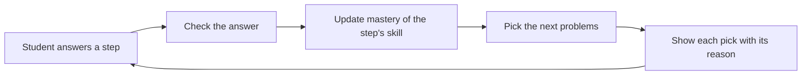

# Grassroot Personalized Practice

A practice engine that checks every step of a physics problem and picks the student's next problems from the step that went wrong, with a one-sentence reason for each.

[](https://github.com/jonathon-lockridge/grassroot-personalized-practice-internship/actions/workflows/ci.yml)

Jonathon Lockridge, a high-school student and product design intern at [Grassroot Academy](https://grassroot.academy), designs and leads the project, with Grassroot's cofounder as his mentor. He wrote the plan ([PRD.md](PRD.md)), chose the subject and the rules for picking problems, and decides how the engine is judged.

Result so far: on 50 simulated students, the engine got 41 to 42 to learn every skill within 600 steps, about twice as many as a teacher's usual order (20 to 22). No real students have used it yet.

Status: the engine, saved student records and the simulated-student test all work (315 automated tests). Jonathon is now checking every physics problem by hand. The student-facing practice page comes next.

## The idea

A right-or-wrong mark on a whole physics problem hides where it went wrong. The student might have picked the wrong principle, found the wrong force, or slipped on the last line. Here each problem is split into steps, and each step practices one skill, so a wrong step points at the skill the student is stuck on. The engine estimates what the student knows, picks the next problems from that estimate, and tells the student why it picked each one.

The engine knows nothing about physics. A course is a data file of skills and problems, so a new subject means a new file and no new code. The first course is AP Physics C: Mechanics, energy and momentum, with 17 skills and 24 problems, the unit Jonathon is studying, so he can judge every problem himself.

## What Jonathon decided

- **Easy and hard picks side by side.** The plan said to give problems a student should get 70 to 85% right. The first engine gave harder problems instead, because they leave more to learn. He chose to keep both: each batch has a "solid" pick near 70 to 85% and "stretch" picks that are harder but still at least half right.
- **The test that counts uses realistic students.** Of the two kinds of simulated students, he chose the ones that need the basics before advanced skills, as real students do, as the bar the engine must pass.
- **Only the engine is real.** On his mentor's suggestion, the practice page will sit inside a minimal, abstracted mock of Grassroot, close to what students learn in class. Only the engine and the data it needs are real.

## An example

A new student works "Box sliding to a stop" and gets step 3 wrong (the box's starting kinetic energy). The engine's next three picks go back to the miss, finish a skill in progress and start a new one. Copied from its output, each line gives the problem's short name, the kind of pick and the reason the student sees:

```text
push_cart      follow_up  Picked for you: you missed step 3 of Box sliding to a stop (Kinetic energy, K = ½mv²), so this problem practices that skill again.
car_power      partway    You are partway to mastering Find a force from Newton's laws: balanced forces, F = ma, friction = μN, so this problem helps you finish it.
bat_hits_ball  new_skill  This problem starts you on Momentum p = mv and impulse J = ∫F dt = Δp.
```

## How it works



| Part | What it does |
|---|---|
| Checking (`checking.py`) | Marks a step right or wrong by its kind: a choice, a typed number within a set tolerance, or items put in order. Text that is not a number, like "five", asks the student to type again instead of counting as wrong. |
| Mastery (`mastery.py`) | Bayesian Knowledge Tracing. For each skill the engine keeps one number from 0 to 1, how likely it is that the student knows it. A right answer raises it unless it could be a guess, a wrong one lowers it unless it looks like a slip, and practice itself can teach the skill. Only first tries count. A skill is mastered at 0.95 with the last 3 first tries right. |
| Next problems (`selection.py`) | Picks the next problems by the rules below. |
| Storage (`storage.py`) | Every answer is kept and never changed, and mastery is worked out again from that history, so the saved numbers always match it. Each pick is saved with its reason. Students go by nicknames, and deleting a student removes all of their data. (One SQLite database file.) |
| Simulation (`simulate.py`) | Simulated students with a hidden true knowledge of each skill, used to compare the engine with other orders. |

### How the next problem is chosen

1. A new student gets a short starting check.
2. A missed skill, or one that needed a hint, goes on a watch list. It comes back until it is right in 2 other problems, one of them at least 12 hours later.
3. Then come skills in progress.
4. Then reviews of mastered skills after 1, 3, 7, 14 and 30 days.
5. Then new skills whose earlier skills are known.

Each batch covers two or three skills and, when choices are tied, mixes unrelated topics. The first pick looks for a problem the student should get 70 to 85% right and is labelled "solid" only if one exists. The others are "stretch": the problem with the most left to learn that the student should still get at least half right. There is no randomness.

## Does it work?

No real students have used it yet; T8 will test it on real people. For now it is tested on simulated students: 50 per run, up to 600 steps each, on the physics course. Three ways of choosing the order of problems run on the same students: the engine, random, and an "expert" order a teacher might use (earlier skills first, each skill's problems from easy to hard).

The result that counts uses learning-curve students. They improve a little with each step, more slowly when an earlier skill is missing, and forget a little each day. That is closer to how real students learn. It is a different model from the engine's, so the engine is not graded by its own math. It does share the course's map of which skills build on which, which the engine also uses, so this test favors any order that teaches the basics first.

On both test runs below, the engine got about twice as many students to learn every skill as the teacher's order, and its students knew more at every checkpoint. A test run's seed fixes the simulation's random draws, so the same seed always prints the same report. The engine's rules were tuned on seeds 1, 7 and 11; seed 3 was never used for tuning.

| Test run (seed) | Order | Learned every skill (of 50) | Average known after 100 / 200 / 300 steps |
|---|---|---|---|
| 1 | Engine | 42 | 46% / 72% / 89% |
| 1 | Expert | 22 | 36% / 69% / 86% |
| 1 | Random | 8 | 35% / 59% / 76% |
| 3 | Engine | 41 | 46% / 72% / 89% |
| 3 | Expert | 20 | 36% / 70% / 87% |
| 3 | Random | 15 | 34% / 60% / 78% |

"Learned every skill" counts students who truly knew every skill at once within 600 steps. "Average known" is the students' average true knowledge.

A second test uses simpler, BKT-like students: each one follows the same kind of model as the engine (knows a skill or not, with guesses and slips, at its own chances) and can learn advanced skills before the basics, which real students mostly cannot. With them the engine still gets the most students to the finish (48 of 50 on both seeds, against 41 and 42 for expert and 36 and 39 for random). But both other orders are ahead early (on seed 1, 65% for expert and 61% for random against 58% after 100 steps), and the engine catches up by 300 steps. Jonathon chose the first kind as the real test because it learns more like real students. The simulated students' settings were fixed before the first run, but they are a model, and real students may learn differently.

## Research behind the design

| What the engine does | Evidence |
|---|---|
| Tracks each skill with Bayesian Knowledge Tracing, mastered at 0.95 | Corbett, A. T., & Anderson, J. R. (1994). Knowledge tracing: Modeling the acquisition of procedural knowledge. *User Modeling and User-Adapted Interaction, 4*(4), 253-278. |
| Holds back a skill until the skills it builds on are known | Gagné, R. M. (1962). The acquisition of knowledge. *Psychological Review, 69*(4), 355-365. |
| Brings mastered skills back after spaced gaps (the growing gaps are a design choice) | Cepeda, N. J., Pashler, H., Vul, E., Wixted, J. T., & Rohrer, D. (2006). Distributed practice in verbal recall tasks: A review and quantitative synthesis. *Psychological Bulletin, 132*(3), 354-380. |
| Mixes topics within a batch | Rohrer, D., & Taylor, K. (2007). The shuffling of mathematics problems improves learning. *Instructional Science, 35*(6), 481-498. |
| Starts every problem with "which principle applies?" | Chi, M. T. H., Feltovich, P. J., & Glaser, R. (1981). Categorization and representation of physics problems by experts and novices. *Cognitive Science, 5*(2), 121-152. |
| Aims solid picks at 70 to 85% right (a result about how machines learn, used here as a rule of thumb, to be checked with real students) | Wilson, R. C., Shenhav, A., Straccia, M., & Cohen, J. D. (2019). The Eighty Five Percent Rule for optimal learning. *Nature Communications, 10*, 4646. |
| Gives stretch picks that are harder but still at least half right | Bjork, R. A. (1994). Memory and metamemory considerations in the training of human beings. In J. Metcalfe & A. Shimamura (Eds.), *Metacognition: Knowing about knowing* (pp. 185-205). MIT Press. |
| Gives every wrong option a message saying why it is wrong | Shute, V. J. (2008). Focus on formative feedback. *Review of Educational Research, 78*(1), 153-189. |

## Project layout

| Path | What it holds |
|---|---|
| `src/practice_engine/models.py` | What a course looks like, and a checker that lists every fault in a course file in plain English |
| `src/practice_engine/checking.py` | Right or wrong for one step |
| `src/practice_engine/mastery.py` | The mastery estimate (Bayesian Knowledge Tracing) |
| `src/practice_engine/selection.py` | The next-problem rules and their reasons |
| `src/practice_engine/storage.py` | Saved students, answers and picks (SQLite) |
| `src/practice_engine/simulate.py` | The simulated-student comparison |
| `src/practice_engine/api.py` | A small web server (FastAPI); for now it only answers a health check |
| `data/ap-physics-c-energy-momentum/` | The physics course and its sources |
| `tests/` | The automated tests, one file per part |
| `PRD.md` / `TODO.md` | The plan, and the small numbered steps of the work |

## Run it

You need Git and Python 3.12 or newer.

```bash
git clone https://github.com/jonathon-lockridge/grassroot-personalized-practice-internship.git
cd grassroot-personalized-practice-internship
cp .env.example .env                          # your own settings file, never uploaded
python3 -m venv .venv                         # a private folder of tools for this project
source .venv/bin/activate                     # Windows: .venv\Scripts\activate
pip install -e ".[dev]"
pytest -q                                     # run the tests
python -m practice_engine.simulate --seed 1   # the simulated-student comparison, about 7 seconds
uvicorn practice_engine.api:app --reload      # web server; open http://127.0.0.1:8000/health
```

Before each commit, with the `.venv` folder active (`source .venv/bin/activate`), run `ruff format . && ruff check . && pytest -q`. GitHub runs the same checks on every push (there `ruff format --check .` only checks the layout instead of fixing it), plus a check that no secret was committed.

## Roadmap

- T1b, checking the course (now): Jonathon works every physics problem on paper and fixes any step that is wrong, unclear or too easy.
- T4, practice page: a practice page inside a minimal mock of Grassroot, where only practice is real and each follow-up shows why it was picked.
- T7, making courses: generate a course from a topic or notes with an AI model; the course checker rejects bad output, and a person reviews what passes.
- T8, real students: try it with friends and classmates under nicknames, with the same five-question check before and after.
- T9, polish and write-up: polish the mock from what T8 shows, and write up the results of T6 and T8.

## Design decisions

Every decision, with the strongest argument against it, is in [PRD.md](PRD.md).

## License

MIT, see [LICENSE](LICENSE). The physics problems were written for this project; topics and formulas follow the College Board's AP Physics C: Mechanics course (see [SOURCES.md](data/ap-physics-c-energy-momentum/SOURCES.md)).
